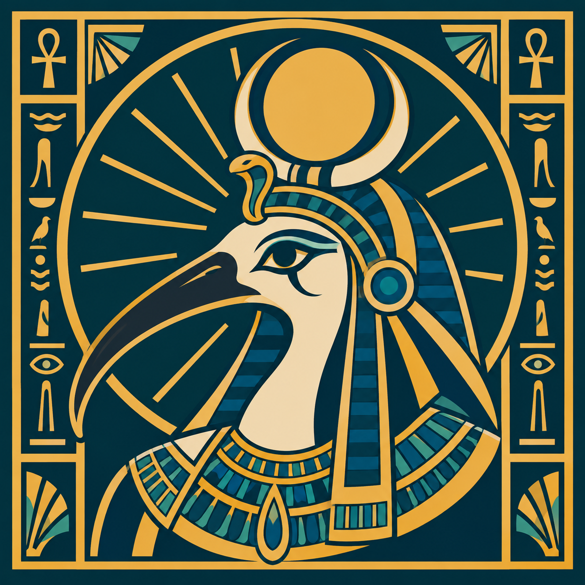

# Tehuti

A desktop environment you drive with a game controller and your voice.

The login session renders on the DRM GPU through GBM/EGL and GLES. If GPU
initialization or scanout setup fails, Tehuti logs the reason and automatically
uses CPU pixman rendering with shared-memory clients. GPU rendering supports
client dma-bufs in both the login session and nested mode, including render-node
feedback when EGL exposes it. Legacy `wl_drm` is enabled when EGL supports it.

## Try it

Run `scripts/try` from a terminal in your desktop. It builds Tehuti, sets up the
speech venv on first run (in `~/.cache/tehuti-speech-venv`), then opens a window
with a foot terminal inside. Tehuti takes the controller exclusively while it runs.

**Emergency escape:** hold Guide (the home button) and Start together for three seconds.
Start alone follows the app mapping. The hold counts only while both buttons
are down. The emergency escape releases the controller. In the Tehuti login
session, it starts Plasma in the same login. Logging out of Plasma starts Tehuti again. Bind
`dist/tehuti-switch` to a KDE shortcut or controller button to do this. It uses
`qdbus org.kde.Shutdown /Shutdown logout`; if qdbus is missing, bind Plasma's
built-in Log Out action instead.

Ctrl+Alt+Backspace in Tehuti ends the login session. Start failures and crashes
open Plasma too, as does phone SSH `pkill -TERM tehuti`. Three Tehuti failures
within 60 seconds keep the session in Plasma until a successful Plasma logout
clears the failure count and retries Tehuti.
If `startplasma-wayland` is missing from PATH, the launcher logs the problem
and retries Tehuti with a delay.

Speech: hold Share to record, release to transcribe. Set `TEHUTI_NO_SPEECH=1` to skip it.

Controllers: physical pads are accepted by default. Set `TEHUTI_VIRTUAL_PAD=Sunshine` to also accept virtual pads whose device name contains that case-sensitive substring. Unset or empty values keep virtual pads disabled. The value is read once at startup and applies to reconnects. Pads must have a south face button.

Scale: `TEHUTI_SCALE` sets the integer output scale, for example `TEHUTI_SCALE=2`.
Without it, modes wider than 2560 pixels use 2 and others use 1. Invalid values
(0, negative or not a whole number) log a warning and use that default. The
nested window honours it too.

`examples/emulator/context.toml` releases the pad grab for an emulator; Guide+Start still exits and Select+LB controls push-to-talk (`pad.push_to_talk`, default Share/Record).

`examples/foot/context.toml` (foot terminal):

- South: Enter. East: Backspace. West: Space. Select: Escape.
- D-pad: arrow keys. North: types `ls -la`. Start: shows a notice.
- Say "Hello" to type `echo hello from Tehuti`, "Enter" for Enter, "Clear" to type `clear`.
  Matching ignores case and punctuation (Unicode included), folds typographic apostrophes
  to `'` and compares NFC-normalized text, so "Hello." and "hello" are the same phrase.

`examples/plugins/east-to-tab` remaps East to Tab, only for apps with app id `test`.
Try it with `target/release/tehuti examples foot -- bash --norc --noprofile` (a plain shell keeps the demo predictable).
