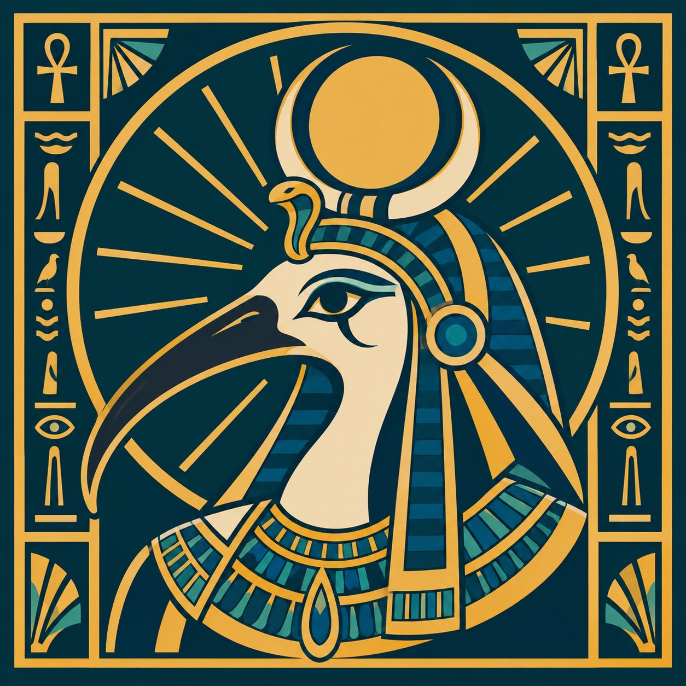

# Tehuti

A desktop environment you drive with a game controller and your voice.

Tehuti is a Wayland compositor and shell. Windows sit in a scrolling row of
columns. A controller moves between them, opens apps and types on an on-screen
keyboard. Hold a button and speak to launch an app, run a command or dictate
text. Speech is transcribed on your machine.

## Status

Tehuti is v0 ("Apteribis"), published as GitHub pre-releases. The author uses it
as a daily desktop, but it is early. Expect rough edges, changing settings and
breaking changes to contexts and plugins. Bug reports are welcome as
[issues](https://github.com/magnus-encoded/tehuti/issues).

## What it does

- **Scrolling columns.** Windows open as columns that scroll sideways. Shoulder
  buttons and the d-pad move focus; the right stick scrolls the focused window.
- **Voice bar.** A bar along the bottom edge shows the focused app, live
  dictation, command results and a clock.
- **Launcher.** Say or type what to open. Results are ranked from your desktop
  entries and your own names for them.
- **On-screen keyboard.** Opens from a text field or by voice, edits with the
  pad, and dictates into its draft.
- **System menu and settings.** Guide opens the menu. Settings cover controller,
  microphone, bar font and wallpapers, all reachable from the pad.
- **Contexts.** A `context.toml` per application maps buttons and spoken
  phrases to keys, text and commands. Contexts reload when you save them.
- **Plugins.** Programs in any language speak JSON-RPC over stdio. See
  [the protocol](docs/protocol/README.md).
- **X11 apps** run through `xwayland-satellite` when it is installed.
- **Rendering.** GPU (GLES) on the login session, with an automatic CPU
  fallback, or nested in a window on your current desktop.

## Try it

Run `scripts/try` from a terminal in your desktop. It builds Tehuti, sets up the
speech venv on first run (in `~/.cache/tehuti-speech-venv`), then opens a window
with a foot terminal inside. Tehuti takes the controller exclusively while it runs.

You need a Rust toolchain, Python 3, `foot`, and the development libraries for
xkbcommon, Wayland, EGL, udev, libseat, libinput, GBM, DRM and Pixman.

Prebuilt x86_64 and i686 Linux builds are on the
[releases page](https://github.com/magnus-encoded/tehuti/releases).

**Emergency escape:** hold Guide (the home button) and Start together for three seconds.
Start alone follows the app mapping. The hold counts only while both buttons
are down. The emergency escape releases the controller. In the Tehuti login
session, it starts Plasma in the same login. Logging out of Plasma starts Tehuti again. Bind
`dist/tehuti-switch` to a KDE shortcut or controller button to do this. It uses
`qdbus org.kde.Shutdown /Shutdown logout`; if qdbus is missing, bind Plasma's
built-in Log Out action instead.

Ctrl+Alt+Backspace in Tehuti ends the login session. Start failures and crashes
open Plasma too, as does phone SSH `pkill -TERM tehuti`. Three Tehuti failures
within 60 seconds keep the session in Plasma until a successful Plasma logout
clears the failure count and retries Tehuti.
If `startplasma-wayland` is missing from PATH, the launcher logs the problem
and retries Tehuti with a delay.

To log in to Tehuti from your display manager, see [dist/README.md](dist/README.md).

## Speech and scale

Hold Share to record, release to transcribe. Set `TEHUTI_NO_SPEECH=1` to skip it.

`TEHUTI_SCALE` sets the integer output scale, for example `TEHUTI_SCALE=2`.
Without it, modes wider than 2560 pixels use 2 and others use 1. Invalid values
(0, negative or not a whole number) log a warning and use that default. The
nested window honours it too.

## Contexts

`examples/foot/context.toml` (foot terminal):

- South: Enter. East: Backspace. West: Space. Select: Escape.
- D-pad: arrow keys. North: types `ls -la`. Start: shows a notice.
- Say "Hello" to type `echo hello from Tehuti`, "Enter" for Enter, "Clear" to type `clear`.
  Matching ignores case and punctuation (Unicode included), folds typographic apostrophes
  to `'` and compares NFC-normalized text, so "Hello." and "hello" are the same phrase.

`examples/plugins/east-to-tab` remaps East to Tab, only for apps with app id `test`.
Try it with `target/release/tehuti examples foot -- bash --norc --noprofile` (a plain shell keeps the demo predictable).

The full context format is in [docs/contexts.md](docs/contexts.md).

## Contributing and licence

Run `scripts/check` before every commit; CI runs the same gate. Review rules are
in [CODING_STANDARDS.md](CODING_STANDARDS.md), and each crate has a
`GLOSSARY.md` listed in [GLOSSARY-MAP.md](GLOSSARY-MAP.md). Design decisions are
recorded in [docs/adr](docs/adr). Licensing, including how contributions are
handled, is decided in [ADR 0004](docs/adr/0004-licensing.md).
